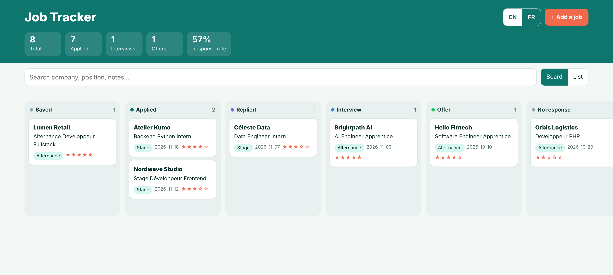

# Job Tracker

[English](README.md) | **Français**

Une petite application web fullstack pour suivre ses candidatures sur un tableau Kanban, de « à postuler » jusqu'à « offre ».
Je l'ai développée pour organiser ma propre recherche d'alternance en tant qu'étudiante à l'École 42 Paris.



## Fonctionnalités

- Tableau Kanban avec glisser-déposer entre les étapes (À postuler, Envoyée, Réponse reçue, Entretien, Offre, Sans réponse, Refusée)
- Vue liste et recherche plein texte
- Statistiques calculées en SQL : nombre de candidatures par étape et taux de réponse
- Un CV (PDF, DOC, DOCX) associé à chaque candidature, pour savoir quelle version a été envoyée
- Niveau d'intérêt, type de contrat, lieu, rémunération, contact et notes pour chaque candidature
- Migration automatique des bases créées par la première version de l'application
- Interface en anglais et en français, modifiable en un clic (choix mémorisé, langue du navigateur utilisée par défaut)
- Mise en page responsive et mode sombre

## Stack technique

| Couche | Choix |
|--------|-------|
| Backend | Python, FastAPI, Pydantic pour la validation |
| Base de données | SQLite en SQL natif (requêtes paramétrées, contraintes CHECK, clés étrangères) |
| Frontend | HTML, CSS, JavaScript natif (Fetch API, glisser-déposer HTML5), sans framework |
| i18n | Petit dictionnaire de traductions en JavaScript avec des attributs `data-i18n` |
| Tests | pytest + TestClient de FastAPI |

## Lancer le projet en local

```bash
git clone https://github.com/luxuanry/job-tracker.git
cd job-tracker
python3 -m venv .venv
source .venv/bin/activate
pip install -r requirements.txt
uvicorn app:app --reload
```

Ouvrir ensuite http://127.0.0.1:8000. Documentation interactive de l'API : http://127.0.0.1:8000/docs

### Essayer avec des données de démonstration

Toutes les entreprises de la démo sont fictives.

```bash
JOB_TRACKER_DB=demo.db python seed_demo.py
JOB_TRACKER_DB=demo.db uvicorn app:app --reload
```

### Lancer les tests

```bash
pip install -r requirements-dev.txt
pytest
```

## API

| Méthode | Route | Description |
|---------|-------|-------------|
| GET | /api/statuses | Valeurs de statut autorisées |
| GET | /api/stats | Nombre par statut et taux de réponse |
| GET | /api/applications | Liste (paramètres optionnels `?status=` et `&search=`) |
| POST | /api/applications | Créer une candidature |
| PATCH | /api/applications/{id} | Modifier certains champs (utilisé par le glisser-déposer) |
| DELETE | /api/applications/{id} | Supprimer une candidature |
| GET | /api/cvs | Lister les CV importés |
| POST | /api/cvs | Importer un CV (multipart, champ `file`, 10 Mo maximum) |
| GET | /api/cvs/{id}/file | Ouvrir ou télécharger un CV |

## Structure du projet

```
app.py            Couche HTTP : routes et validation avec Pydantic
db.py             Accès aux données uniquement (tout le SQL est ici)
seed_demo.py      Remplit une base séparée avec des candidatures fictives
static/index.html Le frontend en une seule page
tests/            Tests de l'API et de la migration
```

## Choix de conception

- **Séparation des couches** : `db.py` ne connaît pas HTTP, `app.py` ne connaît pas SQL.
- **Validation à deux niveaux** : Pydantic refuse les entrées invalides avec une erreur 422 avant qu'elles n'atteignent la base, et les contraintes CHECK de SQLite protègent les données elles-mêmes.
- **Import de fichiers sécurisé** : les CV sont enregistrés sous un nom aléatoire, avec une liste d'extensions autorisées et une taille maximale ; le nom d'origine sert uniquement à l'affichage.
- **i18n légère** : les libellés statiques portent une clé `data-i18n` et les textes dynamiques passent par une fonction `t()`, donc ajouter une langue revient à ajouter un dictionnaire.
- **Confidentialité** : la vraie base de données et les CV importés sont listés dans `.gitignore` et ne sont jamais publiés.
