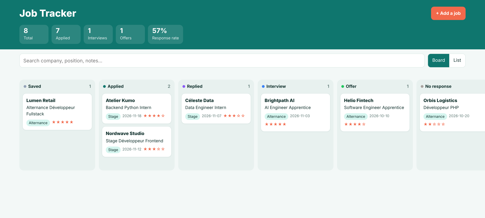

# Job Tracker

A small full-stack web app to follow job applications on a Kanban board, from "saved" to "offer".
I built it to organise my own search for an alternance as a student at École 42 Paris.



## Features

- Kanban board with drag and drop between stages (Saved, Applied, Replied, Interview, Offer, No response, Rejected)
- List view and full-text search
- Header statistics computed in SQL: totals per stage and response rate
- One CV file (PDF, DOC, DOCX) attached to each application, so I know which version I sent
- Excitement rating, job type, location, salary, contact and notes per application
- Automatic migration of databases created by the first version of the app
- Responsive layout and dark mode

## Tech stack

| Layer | Choice |
|-------|--------|
| Backend | Python, FastAPI, Pydantic for validation |
| Database | SQLite with plain SQL (parameterised queries, CHECK constraints, foreign keys) |
| Frontend | HTML, CSS, vanilla JavaScript (Fetch API, HTML5 drag and drop), no framework |
| Tests | pytest + FastAPI TestClient |

## Run it locally

```bash
git clone https://github.com/luxuanry/job-tracker.git
cd job-tracker
python3 -m venv .venv
source .venv/bin/activate
pip install -r requirements.txt
uvicorn app:app --reload
```

Then open http://127.0.0.1:8000. Interactive API docs: http://127.0.0.1:8000/docs

### Try it with demo data

All companies in the demo are fictional.

```bash
JOB_TRACKER_DB=demo.db python seed_demo.py
JOB_TRACKER_DB=demo.db uvicorn app:app --reload
```

### Run the tests

```bash
pip install -r requirements-dev.txt
pytest
```

## API

| Method | Path | Description |
|--------|------|-------------|
| GET | /api/statuses | Allowed status values |
| GET | /api/stats | Counts per status and response rate |
| GET | /api/applications | List (optional `?status=` and `&search=`) |
| POST | /api/applications | Create an application |
| PATCH | /api/applications/{id} | Update some fields (used by drag and drop) |
| DELETE | /api/applications/{id} | Delete an application |
| GET | /api/cvs | List uploaded CVs |
| POST | /api/cvs | Upload a CV (multipart, field `file`, max 10 MB) |
| GET | /api/cvs/{id}/file | Open or download a CV |

## Project structure

```
app.py            HTTP layer: routes and validation with Pydantic
db.py             Database access only (all SQL lives here)
seed_demo.py      Fills a separate database with fictional applications
static/index.html The single-page front end
tests/            API and migration tests
```

## Design notes

- **Separation of layers**: `db.py` knows nothing about HTTP, `app.py` knows nothing about SQL.
- **Validation in two places**: Pydantic rejects bad input with a 422 before it reaches the database, and SQLite CHECK constraints guard the data itself.
- **Safe file uploads**: CVs are saved under random names, with an extension allow-list and a size limit; the original file name is kept only for display.
- **Privacy**: the real database and uploaded CVs are listed in `.gitignore` and never committed.
